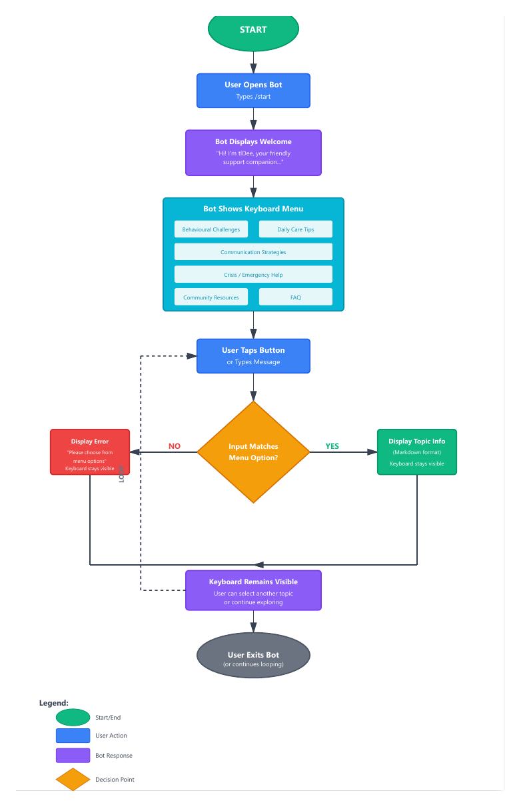

# tIDee: Caregiver Support Telegram Bot

A Telegram bot that gives caregivers of Persons with Intellectual Disabilities (PWIDs) quick, practical guidance through a simple button menu.

> **Status:** Working prototype (May 2026). Built for a friend's caregiver-support project proposal. The project did not go ahead because of costs, so the bot was never deployed publicly.

## Features

- `/start` greets the user and opens a persistent six-button menu
- Six topics, each answered with formatted (Markdown) guidance:
  - Behavioural Challenges
  - Daily Care Tips
  - Communication Strategies
  - Crisis / Emergency Help (including when to call 995 in Singapore)
  - Community Resources (MINDS, SPD, Caregiver Alliance, ComCare and more)
  - FAQ
- Input validation: anything that isn't a menu option gets a friendly prompt to pick from the menu
- The keyboard stays visible, so users can move between topics without retyping commands

## User flow



## Tech stack

- Python 3.10+
- [python-telegram-bot](https://python-telegram-bot.org/) (async `Application`, `CommandHandler`, `MessageHandler`, `ReplyKeyboardMarkup`)
- [python-dotenv](https://pypi.org/project/python-dotenv/) to load the bot token from a `.env` file

## How it works

| Part | What it does |
| --- | --- |
| `MENU_KEYBOARD` | A `ReplyKeyboardMarkup` that lays out the six topic buttons and stays on screen |
| `RESPONSES` | A dictionary that maps each button label to its reply text |
| `start()` | Handles `/start`: sends the welcome message and the menu |
| `handle_text()` | Looks the user's message up in `RESPONSES`; replies with the topic or re-prompts if there's no match |
| `main()` | Reads `BOT_TOKEN`, registers the handlers and starts long polling |

Keeping all content in one dictionary means a new topic only needs one new entry and one new button.

## Run it yourself

1. Create a bot with [@BotFather](https://t.me/BotFather) on Telegram and copy its token.
2. Clone this repo and install the dependencies:

   ```bash
   git clone https://github.com/vikashbalaa/tidee-bot.git
   cd tidee-bot
   python -m venv .venv
   source .venv/bin/activate        # Windows: .venv\Scripts\activate
   pip install -r requirements.txt
   ```

3. Copy `.env.example` to `.env` and paste in your token:

   ```
   BOT_TOKEN=123456789:your-token-here
   ```

4. Start the bot:

   ```bash
   python bot.py
   ```

5. Open your bot in Telegram and send `/start`.

## Project structure

```
tidee-bot/
├── bot.py            # Bot logic and content
├── requirements.txt  # Python dependencies
├── .env.example      # Template for your bot token
├── .gitignore        # Keeps .env and virtual environments out of Git
└── docs/
    └── workflow.png  # User flow diagram
```

## What I'd add next

- An AI chat mode so caregivers can ask questions in their own words
- Inline buttons for sub-topics (for example, separate pages per community resource)
- Webhook deployment on a cloud host instead of long polling
- Unit tests for the message handler

## Disclaimer

tIDee shares general information only and is not a substitute for professional medical, psychological or social-work advice. In an emergency in Singapore, call 995.

## Author

Vikash Bala, Bachelor of Computer Science student (AI & Big Data / Cyber Security), SIM Global Education / University of Wollongong
